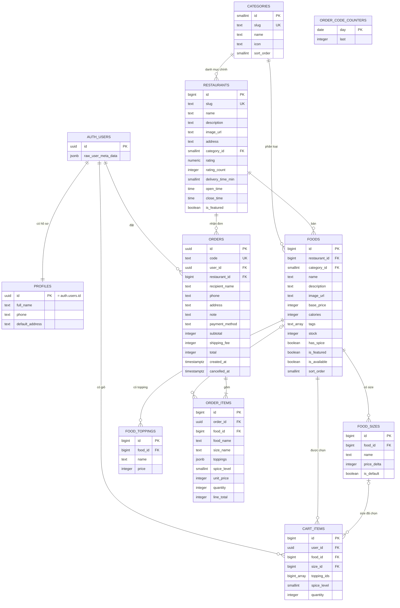

# Cơ sở dữ liệu FoodieGo

FoodieGo dùng **Supabase** (PostgreSQL 17) làm backend:

- **Supabase Auth** quản lý tài khoản.
- **PostgreSQL** lưu thực đơn, hồ sơ, giỏ hàng và đơn hàng.
- **Row Level Security (RLS)** quyết định ai được đọc và ghi dòng nào.
- **RPC** (các hàm PL/pgSQL) xử lý mọi nghiệp vụ cần chạy trong transaction: đặt hàng, hủy đơn, lưu giỏ hàng.

Nguyên tắc thiết kế:

- **Tiền là số nguyên VND.** Không có phần lẻ, nên không bao giờ có sai số làm tròn.
- **Client không bao giờ gửi giá.** `place_order` tự tính mọi con số từ thực đơn.
- **Ghi dữ liệu quan trọng chỉ qua RPC.** Client không có quyền `INSERT` hay `UPDATE` trực tiếp vào `orders` và `foods`.
- **RLS bật trên mọi bảng.** Mỗi người chỉ thấy dữ liệu của mình.
- **Đơn hàng lưu bản chụp.** Tên món và giá được chép vào `order_items` lúc đặt, nên quán đổi giá sau này thì đơn cũ vẫn đúng.

Tất cả SQL nằm trong thư mục `supabase/`:

| File                                         | Nội dung                                                                      |
| -------------------------------------------- | ----------------------------------------------------------------------------- |
| `migrations/20261104000100_menu.sql`         | Thực đơn: `categories`, `restaurants`, `foods`, `food_sizes`, `food_toppings` |
| `migrations/20261104000200_profiles.sql`     | Hồ sơ `profiles` và trigger tạo hồ sơ khi đăng ký                             |
| `migrations/20261104000300_cart_items.sql`   | Giỏ hàng `cart_items` và RPC `replace_cart`                                   |
| `migrations/20261104000400_orders.sql`       | `orders`, `order_items`, `order_code_counters` và RPC `place_order`           |
| `migrations/20261104000500_cancel_order.sql` | RPC `cancel_order`                                                            |
| `seed.sql`                                   | Dữ liệu mẫu, sinh từ `src/data/menuSeed.js` bằng `npm run db:seed`            |
| `tests/all_tests.sql`                        | Toàn bộ kịch bản test, sinh bằng `npm run db:test-bundle`                     |

---

## 1. Sơ đồ quan hệ (ERD)

Sơ đồ có 9 bảng nghiệp vụ, cộng thêm bảng nội bộ `order_code_counters` dùng để đánh số mã đơn trong ngày. `auth.users` là bảng do Supabase Auth quản lý.

---

## 2. Từ điển dữ liệu

Ký hiệu trong các bảng dưới đây: **PK** là khóa chính, **FK** là khóa ngoại, **UK** là giá trị duy nhất, **NN** là không được rỗng (NOT NULL). Mọi bảng có `created_at` hoặc `updated_at` đều là `timestamptz`, mặc định `now()`. Trigger `set_updated_at` tự cập nhật `updated_at` mỗi khi có lệnh `UPDATE`.

### 2.1 `categories`: danh mục món

| Cột          | Kiểu       | Ràng buộc                          | Mô tả                           |
| ------------ | ---------- | ---------------------------------- | ------------------------------- |
| `id`         | `smallint` | PK, identity                       |                                 |
| `slug`       | `text`     | NN, UK, dạng `a-z0-9` nối bằng `-` | Dùng trên URL, ví dụ `bun-pho`  |
| `name`       | `text`     | NN, không rỗng                     | Tên hiển thị, ví dụ "Bún & Phở" |
| `icon`       | `text`     | NN, mặc định 🍽️                    | Emoji hiển thị                  |
| `sort_order` | `smallint` | NN, mặc định 0                     | Thứ tự hiển thị                 |

### 2.2 `restaurants`: quán ăn

| Cột                       | Kiểu           | Ràng buộc                                  | Mô tả                                                                     |
| ------------------------- | -------------- | ------------------------------------------ | ------------------------------------------------------------------------- |
| `id`                      | `bigint`       | PK, identity                               |                                                                           |
| `slug`                    | `text`         | NN, UK, dạng slug                          |                                                                           |
| `name`                    | `text`         | NN, không rỗng                             |                                                                           |
| `description`             | `text`         | NN, mặc định `''`                          |                                                                           |
| `image_url`               | `text`         |                                            | Ảnh bìa (Unsplash)                                                        |
| `address`                 | `text`         | NN, mặc định `''`                          |                                                                           |
| `category_id`             | `smallint`     | FK → `categories.id`, `ON DELETE SET NULL` | Danh mục chính                                                            |
| `rating`                  | `numeric(2,1)` | NN, 0–5                                    | Điểm đánh giá                                                             |
| `rating_count`            | `integer`      | NN, ≥ 0                                    | Số lượt đánh giá                                                          |
| `delivery_time_min`       | `smallint`     | NN, > 0, mặc định 30                       | Thời gian giao (phút)                                                     |
| `open_time`, `close_time` | `time`         | NN                                         | Giờ mở và đóng cửa. `close_time < open_time` nghĩa là quán mở qua nửa đêm |
| `is_featured`             | `boolean`      | NN, mặc định `false`                       | Hiện trên trang chủ                                                       |

### 2.3 `foods`: món ăn

| Cột             | Kiểu       | Ràng buộc                                      | Mô tả                                                                                   |
| --------------- | ---------- | ---------------------------------------------- | --------------------------------------------------------------------------------------- |
| `id`            | `bigint`   | PK, identity                                   |                                                                                         |
| `restaurant_id` | `bigint`   | NN, FK → `restaurants.id`, `ON DELETE CASCADE` | Quán bán món                                                                            |
| `category_id`   | `smallint` | FK → `categories.id`, `ON DELETE SET NULL`     | Nhóm món trong thực đơn                                                                 |
| `name`          | `text`     | NN, không rỗng                                 |                                                                                         |
| `description`   | `text`     | NN, mặc định `''`                              |                                                                                         |
| `image_url`     | `text`     |                                                |                                                                                         |
| `base_price`    | `integer`  | NN, ≥ 0                                        | Giá gốc (VND)                                                                           |
| `calories`      | `integer`  | NN, ≥ 0                                        | kcal, dùng cho AI gợi ý                                                                 |
| `tags`          | `text[]`   | NN, mặc định `{}`, index GIN                   | Khẩu vị: `cay`, `chay`, `it-calo`, `giau-dam`, `no-lau`, `nhe-bung`, `ngot`, `mat-lanh` |
| `stock`         | `integer`  | NN, ≥ 0                                        | Tồn kho **theo món** (không tách theo size). Chỉ RPC được thay đổi                      |
| `has_spice`     | `boolean`  | NN                                             | `true` thì khách được chọn độ cay 0–4                                                   |
| `is_featured`   | `boolean`  | NN                                             | Món nổi bật                                                                             |
| `is_available`  | `boolean`  | NN, mặc định `true`                            | `false` thì món bị ẩn khỏi thực đơn (khác với hết hàng: `stock = 0`)                    |
| `sort_order`    | `smallint` | NN                                             |                                                                                         |

### 2.4 `food_sizes`: size của món

| Cột           | Kiểu       | Ràng buộc                                | Mô tả                                                             |
| ------------- | ---------- | ---------------------------------------- | ----------------------------------------------------------------- |
| `id`          | `bigint`   | PK, identity                             |                                                                   |
| `food_id`     | `bigint`   | NN, FK → `foods.id`, `ON DELETE CASCADE` |                                                                   |
| `name`        | `text`     | NN, UK cùng `food_id`                    | Ví dụ "Thường", "Lớn", "Size L"                                   |
| `price_delta` | `integer`  | NN, ≥ 0                                  | Phụ thu so với giá gốc                                            |
| `is_default`  | `boolean`  | NN                                       | Index duy nhất có điều kiện: **mỗi món tối đa một size mặc định** |
| `sort_order`  | `smallint` | NN                                       |                                                                   |

### 2.5 `food_toppings`: topping của món

| Cột          | Kiểu       | Ràng buộc                                | Mô tả                                           |
| ------------ | ---------- | ---------------------------------------- | ----------------------------------------------- |
| `id`         | `bigint`   | PK, identity                             |                                                 |
| `food_id`    | `bigint`   | NN, FK → `foods.id`, `ON DELETE CASCADE` |                                                 |
| `name`       | `text`     | NN, UK cùng `food_id`                    |                                                 |
| `price`      | `integer`  | NN, ≥ 0                                  | Giá thêm (VND). Topping không giới hạn số lượng |
| `sort_order` | `smallint` | NN                                       |                                                 |

### 2.6 `profiles`: hồ sơ người dùng

| Cột               | Kiểu   | Ràng buộc                                     | Mô tả                                                 |
| ----------------- | ------ | --------------------------------------------- | ----------------------------------------------------- |
| `id`              | `uuid` | PK, FK → `auth.users.id`, `ON DELETE CASCADE` | Quan hệ 1–1 với tài khoản                             |
| `full_name`       | `text` | NN, ≤ 100 ký tự                               |                                                       |
| `phone`           | `text` | NN, rỗng hoặc `^0[35789][0-9]{8}$`            | Số di động Việt Nam, 10 số                            |
| `default_address` | `text` | NN, ≤ 300 ký tự                               | Tự điền ở trang Checkout, được `place_order` cập nhật |

### 2.7 `cart_items`: giỏ hàng của người đã đăng nhập

Khách vãng lai lưu giỏ trong LocalStorage. Khi đăng nhập, giỏ đó được gộp vào bảng này.

| Cột           | Kiểu       | Ràng buộc                                                            | Mô tả                                   |
| ------------- | ---------- | -------------------------------------------------------------------- | --------------------------------------- |
| `id`          | `bigint`   | PK, identity                                                         |                                         |
| `user_id`     | `uuid`     | NN, mặc định `auth.uid()`, FK → `auth.users.id`, `ON DELETE CASCADE` |                                         |
| `food_id`     | `bigint`   | NN, FK → `foods.id`, `ON DELETE CASCADE`                             |                                         |
| `size_id`     | `bigint`   | FK → `food_sizes.id`, `ON DELETE CASCADE`                            | `null` khi món không có size            |
| `topping_ids` | `bigint[]` | NN, CHECK `is_sorted_unique` (tăng dần, không trùng)                 | Cùng một bộ topping chỉ có một cách ghi |
| `spice_level` | `smallint` | NN, 0–4                                                              |                                         |
| `quantity`    | `integer`  | NN, 1–99                                                             |                                         |

**Ràng buộc** `cart_items_line_unique`: `UNIQUE NULLS NOT DISTINCT (user_id, food_id, size_id, spice_level, topping_ids)`. Mỗi lựa chọn (món + size + bộ topping + độ cay) chỉ có **một dòng**, kể cả khi `size_id` là `null`. Đây là quy tắc _"khác size, topping hoặc độ cay thì thành dòng riêng"_ được áp ngay ở tầng database.

### 2.8 `orders`: đơn hàng

| Cột              | Kiểu          | Ràng buộc                                           | Mô tả                                                                     |
| ---------------- | ------------- | --------------------------------------------------- | ------------------------------------------------------------------------- |
| `id`             | `uuid`        | PK, `gen_random_uuid()`                             | Khó đoán, dùng trên URL `/orders/:id`                                     |
| `code`           | `text`        | NN, UK, `^FD-[0-9]{6}-[0-9]{4,}$`                   | Mã dễ đọc, ví dụ `FD-261104-0007`, đánh số lại mỗi ngày theo giờ Việt Nam |
| `user_id`        | `uuid`        | NN, FK → `auth.users.id`, `ON DELETE CASCADE`       |                                                                           |
| `restaurant_id`  | `bigint`      | NN, FK → `restaurants.id` (chặn xóa quán đã có đơn) | Mỗi đơn chỉ một quán                                                      |
| `recipient_name` | `text`        | NN, 2–100 ký tự                                     |                                                                           |
| `phone`          | `text`        | NN, `^0[35789][0-9]{8}$`                            |                                                                           |
| `address`        | `text`        | NN, 5–300 ký tự                                     |                                                                           |
| `note`           | `text`        | NN, ≤ 300 ký tự                                     | Ghi chú cho quán                                                          |
| `payment_method` | `text`        | NN, chỉ `'cod'`                                     | Thanh toán khi nhận hàng                                                  |
| `subtotal`       | `integer`     | NN, ≥ 0                                             | Tạm tính do server tính                                                   |
| `shipping_fee`   | `integer`     | NN, ≥ 0                                             | 15.000đ, hoặc 0 nếu tạm tính ≥ 200.000đ                                   |
| `total`          | `integer`     | NN, CHECK `total = subtotal + shipping_fee`         |                                                                           |
| `created_at`     | `timestamptz` | NN                                                  | Mốc để **suy ra trạng thái giao hàng** (xem mục 4.4)                      |
| `cancelled_at`   | `timestamptz` | ≥ `created_at`                                      | Khác `null` nghĩa là đơn đã hủy                                           |

### 2.9 `order_items`: bản chụp món trong đơn

| Cột                                   | Kiểu       | Ràng buộc                                 | Mô tả                                           |
| ------------------------------------- | ---------- | ----------------------------------------- | ----------------------------------------------- |
| `id`                                  | `bigint`   | PK, identity                              |                                                 |
| `order_id`                            | `uuid`     | NN, FK → `orders.id`, `ON DELETE CASCADE` |                                                 |
| `food_id`                             | `bigint`   | FK → `foods.id`, `ON DELETE SET NULL`     | Để hoàn kho khi hủy. Món bị xóa thì đơn vẫn còn |
| `food_name`, `image_url`, `size_name` | `text`     | `food_name` NN                            | Chép từ thực đơn lúc đặt                        |
| `toppings`                            | `jsonb`    | NN, phải là mảng                          | `[{ "id", "name", "price" }]` lúc đặt           |
| `spice_level`                         | `smallint` | NN, 0–4                                   |                                                 |
| `unit_price`                          | `integer`  | NN, ≥ 0                                   | (giá gốc + phụ thu size + Σ topping) lúc đặt    |
| `quantity`                            | `integer`  | NN, 1–99                                  |                                                 |
| `line_total`                          | `integer`  | NN, CHECK `= unit_price × quantity`       |                                                 |

### 2.10 `order_code_counters`: bảng nội bộ

| Cột    | Kiểu      | Ràng buộc | Mô tả                              |
| ------ | --------- | --------- | ---------------------------------- |
| `day`  | `date`    | PK        | Ngày theo giờ Việt Nam             |
| `last` | `integer` | NN        | Số thứ tự đơn cuối cùng trong ngày |

Bảng này bật RLS nhưng **không có policy** và không cấp quyền cho ai, nên không truy cập được qua API. Chỉ `place_order` dùng nó. Trình kiểm tra bảo mật của Supabase báo mục này ở mức INFO; đây là cố ý.

### 2.11 Index

Ngoài các index tự tạo cho khóa chính và UNIQUE, database có thêm:

| Index                                                                                | Dùng cho                           |
| ------------------------------------------------------------------------------------ | ---------------------------------- |
| `restaurants(category_id)`, `foods(restaurant_id)`, `foods(category_id)`             | Join và lọc theo danh mục          |
| `restaurants(is_featured) WHERE is_featured`, `foods(is_featured) WHERE is_featured` | Trang chủ                          |
| `foods USING gin (tags)`                                                             | Lọc theo khẩu vị                   |
| `food_sizes(food_id)`, `food_toppings(food_id)`                                      | Tải size và topping kèm món        |
| `food_sizes(food_id) WHERE is_default` (UNIQUE)                                      | Mỗi món một size mặc định          |
| `cart_items(user_id)`, `cart_items(food_id)`, `cart_items(size_id)`                  | Đọc giỏ, khóa ngoại                |
| `orders(user_id, created_at DESC)`                                                   | "Đơn hàng của tôi", mới nhất trước |
| `orders(restaurant_id)`, `order_items(order_id)`, `order_items(food_id)`             | Join, hoàn kho                     |

---

## 3. Phân quyền và Row Level Security

Supabase có hai vai trò cho client: `anon` (chưa đăng nhập) và `authenticated` (đã đăng nhập). `auth.uid()` là id của người đang gọi, lấy từ JWT.

Mỗi bảng có hai lớp bảo vệ:

1. **GRANT** quyết định vai trò được phép làm thao tác nào trên bảng.
2. **Policy RLS** quyết định được thao tác trên **những dòng nào**.

| Bảng                                                       | `anon` | `authenticated`                                              | Điều kiện dòng (RLS)                                      |
| ---------------------------------------------------------- | ------ | ------------------------------------------------------------ | --------------------------------------------------------- |
| `categories`, `restaurants`, `food_sizes`, `food_toppings` | SELECT | SELECT                                                       | Mọi dòng                                                  |
| `foods`                                                    | SELECT | SELECT                                                       | `is_available = true`                                     |
| `profiles`                                                 | —      | SELECT, UPDATE (chỉ `full_name`, `phone`, `default_address`) | `id = auth.uid()` (UPDATE có cả `USING` lẫn `WITH CHECK`) |
| `cart_items`                                               | —      | SELECT, INSERT, DELETE, UPDATE (chỉ `quantity`)              | `user_id = auth.uid()`                                    |
| `orders`                                                   | —      | SELECT                                                       | `user_id = auth.uid()`                                    |
| `order_items`                                              | —      | SELECT                                                       | Đơn cha thuộc `auth.uid()`                                |
| `order_code_counters`                                      | —      | —                                                            | Không có policy, không truy cập được                      |

Thực đơn bị thu hồi mọi quyền `INSERT`, `UPDATE`, `DELETE`, `TRUNCATE` từ `anon` và `authenticated`. Đây là lớp chặn thứ hai, phòng khi một policy bị viết sai.

### Quyền gọi hàm (RPC)

| Hàm                                        | Chạy với quyền | `anon` | `authenticated` | Ghi chú                                                         |
| ------------------------------------------ | -------------- | ------ | --------------- | --------------------------------------------------------------- |
| `replace_cart(items jsonb)`                | **invoker**    | —      | ✔               | Chạy với quyền của người gọi nên RLS vẫn áp dụng                |
| `place_order(items jsonb, delivery jsonb)` | **definer**    | —      | ✔               | Cần quyền trừ `foods.stock` và ghi `orders`, mà client không có |
| `cancel_order(order_id uuid)`              | **definer**    | —      | ✔               | Cần quyền ghi `orders.cancelled_at` và cộng lại `foods.stock`   |
| `handle_new_user()`                        | definer        | —      | —               | Chỉ trigger gọi, không ai gọi trực tiếp được                    |
| `set_updated_at()`, `is_sorted_unique()`   | invoker        |        |                 | Hàm phụ cho trigger và CHECK                                    |

Hai hàm `place_order` và `cancel_order` chạy với quyền `SECURITY DEFINER`. Trình kiểm tra bảo mật của Supabase cảnh báo rằng người đã đăng nhập gọi được chúng; đây là **thiết kế có chủ đích**. Hai hàm được bảo vệ như sau:

- Lấy người dùng **chỉ** từ `auth.uid()`, không bao giờ nhận user id từ client.
- Kiểm tra từng tham số đầu vào, và tự tính mọi con số tiền.
- Đặt `search_path = ''` và ghi đầy đủ tên schema cho mọi đối tượng, để không ai chèn được bảng hay hàm giả vào đường tìm kiếm.
- Thu hồi quyền `EXECUTE` từ `PUBLIC` và `anon`.

---

## 4. Trigger và các luồng nghiệp vụ

### 4.1 Trigger

| Trigger                                      | Bảng                                             | Thời điểm     | Việc làm                                            |
| -------------------------------------------- | ------------------------------------------------ | ------------- | --------------------------------------------------- |
| `*_set_updated_at`                           | `restaurants`, `foods`, `profiles`, `cart_items` | BEFORE UPDATE | Gán `updated_at = now()`                            |
| `on_auth_user_created` → `handle_new_user()` | `auth.users`                                     | AFTER INSERT  | Tạo dòng `profiles` cho tài khoản mới, xem bên dưới |

`handle_new_user` điền **họ tên** và **số điện thoại** từ `raw_user_meta_data`, là phần metadata client gửi kèm lúc đăng ký:

1. Cắt khoảng trắng ở tên và giới hạn 100 ký tự.
2. Bỏ mọi ký tự không phải số trong số điện thoại. Kết quả không khớp định dạng Việt Nam thì để rỗng, để việc đăng ký không bao giờ thất bại vì dữ liệu phụ.
3. Dùng `ON CONFLICT DO NOTHING`, nên chạy lại không sinh lỗi.

Metadata này do người dùng tự gửi lên, nên **chỉ dùng để điền sẵn hồ sơ**, không bao giờ dùng để phân quyền.

### 4.2 `replace_cart(items)`: lưu giỏ hàng

- **Đầu vào**: `items` là mảng `[{ foodId, sizeId, toppingIds, spiceLevel, quantity }]`. Đây là **toàn bộ giỏ** hiện tại, không phải phần thay đổi.
- **Luồng**, chạy trong một transaction:
  1. Không có `auth.uid()` thì báo lỗi `42501`. `items` không phải mảng thì báo lỗi `22023`.
  2. Xóa toàn bộ `cart_items` của người gọi.
  3. Chuẩn hóa `toppingIds`: bỏ trùng, sắp xếp tăng dần.
  4. **Gộp các dòng trùng lựa chọn** và cộng dồn số lượng, tối đa 99.
  5. `INSERT … ON CONFLICT (cart_items_line_unique) DO UPDATE`. Nếu hai lần gọi chạy song song, lần ghi sau thắng.

Phía client, các lần lưu được **xếp hàng**: mỗi lúc chỉ một request chạy, và các thay đổi dồn lại trong lúc chờ chỉ gửi trạng thái mới nhất.

### 4.3 `place_order(items, delivery)`: đặt hàng

- **Đầu vào**:
  - `items`: `[{ foodId, sizeId, toppingIds, spiceLevel, quantity }]`, **không có giá**.
  - `delivery`: `{ recipientName, phone, address, note }`.
- **Trả về**: `{ id, code, total }`.

Toàn bộ các bước dưới đây chạy trong **một transaction**. Bất kỳ bước nào báo lỗi thì mọi thay đổi đều bị hủy.

| Bước | Kiểm tra / hành động                                                                                                                                                                            | Lỗi (`message`)                                                                 |
| ---- | ----------------------------------------------------------------------------------------------------------------------------------------------------------------------------------------------- | ------------------------------------------------------------------------------- |
| 1    | Phải có `auth.uid()`                                                                                                                                                                            | `not_authenticated`                                                             |
| 2    | `items` là mảng và không rỗng                                                                                                                                                                   | `empty_cart`                                                                    |
| 3    | Người nhận 2–100 ký tự, số điện thoại Việt Nam, địa chỉ 5–300 ký tự, ghi chú ≤ 300 ký tự                                                                                                        | `invalid_delivery`                                                              |
| 4    | Mỗi dòng có `foodId` và `quantity` trong khoảng 1–99                                                                                                                                            | `invalid_item`                                                                  |
| 5    | **Khóa các dòng `foods` liên quan** bằng `SELECT … FOR UPDATE`, theo thứ tự id để tránh deadlock                                                                                                |                                                                                 |
| 6    | Món tồn tại và đang bán. `sizeId` thuộc món (bỏ trống thì lấy size mặc định; món không có size thì `sizeId` phải rỗng). Mọi `toppingIds` thuộc món. Độ cay 0–4 (món không có cay thì phải là 0) | `invalid_item`                                                                  |
| 7    | Mọi món cùng một quán                                                                                                                                                                           | `mixed_restaurants`                                                             |
| 8    | Tồn kho đủ, tính trên **tổng mọi dòng của cùng một món**                                                                                                                                        | `out_of_stock`, kèm `detail` là JSON `[{ foodId, name, requested, available }]` |
| 9    | **Tự tính giá**: đơn giá = `base_price + price_delta + Σ topping.price`; tạm tính = Σ (đơn giá × số lượng)                                                                                      |                                                                                 |
| 10   | Tạm tính ≥ 50.000đ                                                                                                                                                                              | `below_minimum`, kèm `detail` `{ subtotal, minimum }`                           |
| 11   | Phí ship = 0 nếu tạm tính ≥ 200.000đ, còn lại là 15.000đ                                                                                                                                        |                                                                                 |
| 12   | Trừ `foods.stock`                                                                                                                                                                               |                                                                                 |
| 13   | Tăng `order_code_counters` của ngày hôm nay (giờ Việt Nam), sinh mã `FD-YYMMDD-NNNN`                                                                                                            |                                                                                 |
| 14   | Ghi `orders` và `order_items` (bản chụp tên món, size, topping và giá)                                                                                                                          |                                                                                 |
| 15   | Xóa `cart_items` của người dùng. Lưu `default_address` vào hồ sơ, đồng thời điền họ tên và số điện thoại nếu hồ sơ đang trống                                                                   |                                                                                 |

Các mức phí (15.000đ, 200.000đ, 50.000đ) phải **khớp** với `src/lib/constants.js`. Client dùng cùng các con số này để hiển thị trước, nhưng chỉ số tiền do server tính mới được ghi vào đơn.

### 4.4 Trạng thái giao hàng

Trạng thái **không lưu** trong database, mà được hàm thuần `orderStatus(order, now)` (`src/lib/orderStatus.js`) suy ra từ `created_at`:

| Thời gian kể từ `created_at` | Trạng thái    | Hủy được? |
| ---------------------------- | ------------- | --------- |
| 0 – 30 giây                  | Đang chuẩn bị | ✔         |
| 30 – 90 giây                 | Đang giao     | ✘         |
| Từ 90 giây                   | Đã giao       | ✘         |
| Có `cancelled_at`            | Đã hủy        | ✘         |

Nhờ vậy tải lại trang hay mở trên máy khác vẫn ra đúng trạng thái, mà không cần một tiến trình nền nào cập nhật đơn. Các mốc thời gian để ngắn cho tiện demo.

### 4.5 `cancel_order(order_id)`: hủy đơn và hoàn kho

- **Đầu vào**: `order_id uuid`.
- **Trả về**: `{ id, cancelledAt }`.

Các bước chạy trong một transaction:

| Bước | Kiểm tra / hành động                                                                                                                 | Lỗi (`message`)                                                                         |
| ---- | ------------------------------------------------------------------------------------------------------------------------------------ | --------------------------------------------------------------------------------------- |
| 1    | Phải có `auth.uid()`                                                                                                                 | `not_authenticated`                                                                     |
| 2    | Tìm đơn theo `id` **và** `user_id = auth.uid()`, rồi khóa dòng bằng `FOR UPDATE` để hai lần bấm hủy song song không hoàn kho hai lần | `order_not_found`: báo cả khi đơn thuộc người khác, để không ai dò được đơn nào tồn tại |
| 3    | Đơn chưa hủy                                                                                                                         | `already_cancelled`                                                                     |
| 4    | `now() − created_at < 30 giây`, tính theo **đồng hồ máy chủ**                                                                        | `too_late`                                                                              |
| 5    | Gán `cancelled_at = now()`                                                                                                           |                                                                                         |
| 6    | Cộng lại `foods.stock` theo `order_items`. Món đã bị xóa khỏi thực đơn (`food_id` là `null`) thì bỏ qua                              |                                                                                         |

---

## 5. Kịch bản test SQL

Ba file test tự kiểm tra kết quả: đạt thì in dòng `PASS …`, sai thì dừng với lỗi `FAIL …`. Mỗi file bọc trong `BEGIN … ROLLBACK`, nên **chạy trên production cũng không để lại dữ liệu nào**. Các tài khoản thử chỉ tồn tại trong transaction đó.

Để chạy tất cả một lần, dán `supabase/tests/all_tests.sql` vào **SQL Editor** rồi bấm **Run**. Sau khi sửa một file test, sinh lại file gộp bằng `npm run db:test-bundle`.

Kết quả mong đợi: **21 dòng `PASS`** trong tab Messages.

| #   | Phần     | Kết quả mong đợi                                                                                                                                                          |
| --- | -------- | ------------------------------------------------------------------------------------------------------------------------------------------------------------------------- |
| 1.1 | RLS      | Trigger tạo hồ sơ: tên được cắt khoảng trắng, số điện thoại `090 123 4567` thành `0901234567`, số sai định dạng bị bỏ                                                     |
| 1.2 | RLS      | Người đã đăng nhập đọc được thực đơn, nhưng sửa tồn kho hay thêm danh mục đều bị từ chối                                                                                  |
| 1.3 | RLS      | A chỉ thấy hồ sơ của mình, không sửa được tên của B, không đổi được `id`, không lưu được số điện thoại sai                                                                |
| 1.4 | RLS      | `replace_cart` gộp hai dòng có topping khác thứ tự thành một dòng số lượng 5. Topping chưa sắp xếp bị CHECK chặn. Không thêm được dòng vào giỏ của người khác             |
| 1.5 | RLS      | B không thấy giỏ và hồ sơ của A                                                                                                                                           |
| 1.6 | RLS      | `anon` đọc được thực đơn, nhưng không đọc được hồ sơ và không gọi được `replace_cart`                                                                                     |
| 2.1 | Đặt hàng | **Đặt quá kho** (4 phần Bún bò Huế, kho còn 3) bị từ chối với `out_of_stock`, `detail` chỉ đúng món, **kho không đổi**                                                    |
| 2.2 | Đặt hàng | **Giá giả** (`unitPrice: 1`, `total: 1`) bị bỏ qua: tổng tính đúng 70.000 + 15.000 = 85.000đ. Mã đơn đúng dạng, kho giảm 1, giỏ được xóa, địa chỉ được lưu, bản chụp đúng |
| 2.3 | Đặt hàng | **Size hoặc topping không thuộc món** bị từ chối với `invalid_item`                                                                                                       |
| 2.4 | Đặt hàng | **Đơn dưới tối thiểu** (35.000đ) bị từ chối với `below_minimum`                                                                                                           |
| 2.5 | Đặt hàng | Đơn trộn món của hai quán bị từ chối với `mixed_restaurants`                                                                                                              |
| 2.6 | Đặt hàng | `INSERT` và `UPDATE` trực tiếp vào `orders` bị từ chối (`insufficient_privilege`)                                                                                         |
| 2.7 | Đặt hàng | Thông tin giao hàng sai bị từ chối với `invalid_delivery`                                                                                                                 |
| 2.8 | Đặt hàng | **Truy cập chéo tài khoản**: B không đọc được đơn và món trong đơn của A                                                                                                  |
| 2.9 | Đặt hàng | `anon` không gọi được `place_order`                                                                                                                                       |
| 3.1 | Hủy đơn  | **Hủy đơn đang chuẩn bị**: `cancelled_at` được gán và **kho được hoàn đúng 2 phần**                                                                                       |
| 3.2 | Hủy đơn  | Hủy lần hai bị từ chối với `already_cancelled`, kho không bị cộng thêm                                                                                                    |
| 3.3 | Hủy đơn  | Đơn đặt từ 1 phút trước bị từ chối với `too_late`                                                                                                                         |
| 3.4 | Hủy đơn  | Đơn không tồn tại bị từ chối với `order_not_found`                                                                                                                        |
| 3.5 | Hủy đơn  | **B không hủy được đơn của A**: lỗi `order_not_found`                                                                                                                     |
| 3.6 | Hủy đơn  | `anon` không gọi được `cancel_order`                                                                                                                                      |

Ngoài SQL, phần logic phía client có hơn 190 test Vitest (`npm test`), chạy trong CI ở mọi lần push.

---

## 6. Dựng lại database từ đầu

Toàn bộ thao tác làm trong Supabase Dashboard của project, phần **SQL Editor** → **New query**.

1. **Chạy 5 migration theo đúng thứ tự tên file**, mỗi file một lần Run:
   1. `supabase/migrations/20261104000100_menu.sql`
   2. `supabase/migrations/20261104000200_profiles.sql`
   3. `supabase/migrations/20261104000300_cart_items.sql`
   4. `supabase/migrations/20261104000400_orders.sql`
   5. `supabase/migrations/20261104000500_cancel_order.sql`

   Mỗi file chạy lại được nhiều lần (`create … if not exists`, `drop … if exists`, `create or replace`).

2. **Nạp dữ liệu mẫu**: chạy `supabase/seed.sql`, gồm 6 danh mục, 7 quán, 41 món, 36 size và 37 topping.
3. **Cấu hình Auth**: vào Authentication → Sign In / Providers → Email, **tắt "Confirm email"** để người dùng đăng ký xong là đăng nhập được ngay.
4. **Kiểm tra**: chạy `supabase/tests/all_tests.sql`. Kết quả phải là 21 dòng `PASS`.
5. **Nối ứng dụng**: lấy URL của project và publishable key ở Project Settings → API. Đặt hai giá trị này vào `VITE_SUPABASE_URL` và `VITE_SUPABASE_ANON_KEY` ở cả ba nơi: file `.env` khi chạy ở máy, Vercel (Production và Preview), và GitHub Secrets.

Hai lưu ý quan trọng khi làm theo các bước trên:

- **`seed.sql` xóa sạch thực đơn rồi nạp lại**, bằng `TRUNCATE … CASCADE`. Vì `cart_items`, `orders` và `order_items` đều tham chiếu tới thực đơn, lệnh này cũng **xóa toàn bộ giỏ hàng và đơn hàng**. Chỉ chạy seed trên database mới, hoặc khi chấp nhận mất các dữ liệu đó.
- **Copy SQL phải giữ đúng bảng mã UTF-8.** Nếu copy bằng công cụ dùng sai bảng mã (ví dụ `pbcopy` khi không đặt `LC_ALL=en_US.UTF-8`), chữ tiếng Việt sẽ bị lỗi font khi lưu vào database.

Muốn sửa dữ liệu mẫu thì sửa `src/data/menuSeed.js`, chạy `npm run db:seed` để sinh lại `seed.sql`, rồi chạy lại file đó. Chỉ được **thêm món mới vào cuối mảng**, vì id của món tính theo thứ tự trong mảng.
